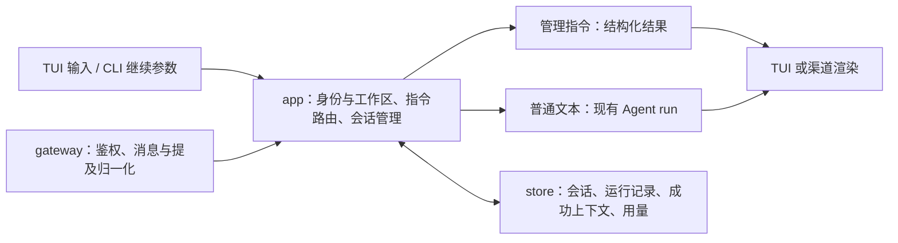

# 历史会话与统一斜杠指令方案

> **G4a.1 含全部修复于 2026-10-12 通过；G4a.2 同日获实施授权，尚未编码或交付。** 用户于 2026-10-11 授权实施持久历史与显式继续并修复审核发现，2026-10-12 授权提交推送全部改动，随后实施 G4a.2。当前实现与验证以 [G4a.1 审核记录](../reviews/G4a.1.md) 和 [修复复审](../reviews/G4a.1-fixes-2026-10-11.md) 为准；公共指令、浏览分页与 fake gateway 是下一单元实施要求，真实 gateway 仍属后续规划。
>
> 用户已确认启动习惯：**裸 `plume` 新会话，带 `-c` 继续最近历史，保留 `/resume`。** 将 G4a 的历史部分拆为 G4a.1、G4a.2；长期记忆仍单独保留。真实渠道仍按 G2a.1 → G2a.2 → G2b 审核，不因本文提前实现微信、飞书、QQ、群聊或 MCP/skill。

本文 frontmatter 的 `active` 表示现行规划文档；路线图中 G4a.1 为“已通过”，G4a.2 当前为“未开始”，说明注明已获授权、待 G4a.1 提交推送后开始编码。G4a.2 的实施授权不等于实现审核通过，交付后仍须单独审核。

## 1. 目标与现状

这次解决三个问题：退出后能找到并继续之前的对话；常用操作有统一的 `/` 入口；未来接入不同 gateway 时复用同一套会话和指令逻辑。

G4a.1 已新增 `internal/store` 的 SQLite 历史与 `internal/app` 持久化集成；Ctrl+N 新建会话 ID、清空内存历史与工具读取证明，旧会话保留。`-c` 只把成功完整轮次预灌下一次模型请求，失败/取消/中断作为展示记录恢复。TUI 已有取消、清屏、草稿历史等键位，尚无公共指令路由；`/demo ...` 是 offline 演示特例。`internal/channel` 仍只有渠道注册信息。后续在这些边界上扩展，不把输入草稿、聊天历史和长期记忆混为一谈。

首批不做自动压缩、语义检索、跨渠道账号绑定、后台继续执行、删除/导出历史、动态加载命令插件，也不让模型解释或执行管理指令。

## 2. 用户使用方式

### 2.1 启动、继续与查找

| 入口 | 拟议行为 |
| --- | --- |
| `plume` / `plume chat` | 创建新会话；以前的会话保留 |
| `plume -c` / `plume --continue` | 恢复当前工作区最近有运行记录的本地 TUI 会话 |
| `plume chat -c` | 与根命令 `-c` 相同 |
| `/resume` | TUI 打开历史选择列表；gateway 返回可见会话列表与恢复用法 |
| `/resume <id>` | 恢复明确指定且有权限的会话，TUI 与 gateway 语义相同 |
| `/sessions [页码]` | 按最近活动排列会话目录，显示短 ID、标题、更新时间、轮数及是否可继续 |

“当前工作区”取最终工具工作目录的规范绝对路径（解析符号链接），不是 Git 分支名；不同 worktree 属于不同工作区。同一目录通过符号链接进入仍匹配同一工作区，目录移动后首版不自动关联旧记录。

`-c` 只搜索本地身份、当前工作区；最近活动按 run 的开始/结束时间排序，重命名、浏览或仅打开空会话不抢占“最近”。找不到历史时明确提示并创建新会话；数据库损坏、目标被占用或配置不兼容时明确报错，不偷偷换成另一个会话。当前会话也可以再次 `/resume`，结果为无操作。

恢复默认按目标会话保存的 `model_ref` 装配运行时，即使当前 `default_model` 已改变，也不会改用新的默认模型。这里允许的是重新打开旧会话及其模型；首版后移的是把**同一会话**迁移给另一个模型。未找到历史的新会话仍使用当前默认模型或显式 `--model`。

仅含失败/取消/中断 run 的会话也算历史，可由 `-c` 找到；恢复后模型上下文可以为空，界面保留失败记录，等待新的输入，绝不把旧输入自动发送。默认标题且没有 run 的会话只保存在当前进程中，首次普通输入或手工命名时再落盘；不会因每次打开又退出产生大量空记录。显式命名的空会话可列出并由 `/resume <id>` 打开，但不参与 `-c` 最近历史选择。

根命令和 `chat` 共用继续参数处理；`setup/config/version` 不继承此标志。缺配置仍遵循首次 setup 流程，不会 setup 完就自动重发旧消息。`chat --offline` 使用内存存储，拒绝与 `-c` 组合，保持不读取真实配置/历史/人格的保证。

### 2.2 首批公共指令

| 指令 | 功能 | run 运行时 |
| --- | --- | --- |
| `/help [指令]` 或 `/` | 显示当前入口实际支持的命令和用法 | 可用 |
| `/new [标题]` | 建立空上下文的新会话并切换；保留旧会话 | 拒绝，提示先取消 |
| `/sessions [页码]` | 查询当前权限域和工作区的会话目录 | 可用 |
| `/resume [id]` | 选择或恢复历史会话 | 拒绝，提示先取消 |
| `/rename <标题>` | 修改当前会话标题 | 拒绝，提示先取消 |
| `/history [页码] [--session <id>]` | 只读查看当前或指定可见会话的已保存记录；不切换绑定、不需要目标模型可用 | 可用，读取已提交快照 |
| `/status` | 当前会话 ID、运行状态、模型、历史轮数、用量及持久化状态 | 可用 |
| `/model` | 查看当前模型与已配置模型引用；首版只读 | 可用 |
| `/cancel`，别名 `/stop` | 请求取消当前 run；空闲时返回没有活动任务 | 可用 |

会话初始标题为 `New conversation`；首次普通输入取首个非空行并按 Unicode 字符裁为至多 60 字，不额外调用模型生成标题。手工标题为 1–120 个 Unicode 字符，拒绝换行与控制字符；`/new` 的标题可省略，`/rename` 不可省略。手工标题不会被后续输入覆盖。

会话目录页码从 1 开始，每页默认 20 项；`/history` 每页默认 20 个 run，第一页显示最近一页，页内按发生顺序排列。历史展示默认折叠 Thought 与工具详情，gateway 只回正文摘要及终态，不主动发送原始工具参数、结果或 Thought。这不会删减供模型恢复的完整结构化成功历史。

`/history --session <id>` 是目标模型已删除或不兼容时的只读入口；TUI 的 `/resume` 列表也提供预览，并显示不可继续的原因。预览不切换当前会话，不尝试装配模型、不联网。各入口仍要通过同一权限域和工作区检查，不能靠只读绕过隔离。整库损坏时不承诺还能读出记录，明确报存储错误。

暂不实现 `/model <ref>`、`/think`、`/compact`、`/memory`、`/skill`、`/mcp`、`/setup`。前两项涉及运行时重建和跨模型历史兼容，单独设计；其余不能以空实现冒充能力。不认识的命令明确报错并提示 `/help`。

### 2.3 本地操作与 TUI 表现

- `/clear` 对应现有 Ctrl+L 的清屏/重绘操作，保留模型上下文与磁盘历史，不等于 `/new`。
- `/exit`（别名 `/quit`）退出当前 TUI，执行取消与资源关闭流程；收尾期限见 §4.4，不因数据库或工具阻塞无限等待。
- Ctrl+N 在 **G4a.1** 就必须调用会话管理器建立新 ID，不能继续直接清空持久会话的内存；G4a.2 的 `/new` 再复用它。未打开建议/选择器时 Esc 直接请求取消，键位取消不依赖文本解析器。
- 输入 `/` 时显示可用命令和简短说明；Tab 补全命令名，Enter 只执行已经输入完整的指令，不自动执行候选首项。Esc 优先关闭建议/选择器，再次按才按现有取消语义处理；Ctrl+C 在 running 时仍立即请求取消。命令表与 `/help` 共用，键位经 KeyMap 表达。没有建议面板时仍可完整输入指令执行。
- 恢复后 TUI 从已保存记录重建显示，包含未完成标记；输入草稿和 Up/Down 草稿历史不从磁盘恢复。切换会话后清空本地草稿历史，避免不同会话的输入混用。
- 会话 ID/标题放在历史选择器和 `/status` 中，首批不再给已有底部状态栏增加默认字段。

选择器 Esc 退出不改变会话与原草稿；恢复失败也保留原会话、草稿和界面。切换成功后再替换界面、统计与工具执行状态，不能先清屏再发现目标打不开。新建和恢复均不触发模型请求。

gateway 收到 `/clear`、`/exit`、`/quit` 时返回此入口不支持，不退出服务、不删除平台聊天记录。恢复成功只发会话摘要，用户通过 `/history` 查看过去内容，避免刷屏。

## 3. 指令解析与应用边界



解析器与命令目录放在 app，保持纯解析；命令处理器通过会话管理/存储接口执行操作，不导入终端或平台 SDK。暂不建立插件式 command 包。TUI 和 gateway 只负责输入适配、选择器及输出格式，不各自实现 `/new` 或 prompt。

解析约定：

1. 只处理用户本次主动输入的顶层文本，命令名为大小写敏感的小写 ASCII。忽略开头空格与 Tab 后判断首字符；命令必须单行，参数作为普通文本解析，不执行 Shell，不做环境变量展开。多行输入若以单 `/` 开头则返回用法错误，避免把命令后的正文丢弃。
2. `//内容` 作为转义，去掉一个 `/` 后按普通消息发送，例如 `//tmp/a.txt` 把 `/tmp/a.txt` 交给模型；转义后的整条内容不再次进入命令解析，也允许多行。代码围栏、引用正文、模型输出和工具结果中的 `/` 不触发命令。
3. 未知命令、参数错误、权限不足、不支持入口直接返回结构化错误，不调用模型，也不写入模型历史。指令及回执不消耗模型轮次；管理操作可以有不含正文的 trace。
4. TUI 必须先把输入交给指令路由，再执行普通消息的 busy 检查，否则 `/cancel` 会被拦在外面。忙时只读命令读取稳定快照，普通消息仍拒绝，不增加隐式队列。
5. 新建、恢复、重命名与 run 准入共用互斥边界。发出取消请求不代表已结束，直到旧 run 到达终态才能切换。所有异步事件携带 session ID 和 run ID，旧会话事件不能更新新会话界面。

ID 使用随机生成的稳定完整值，显示短前缀；短前缀至少 8 位，必须在当前可见集合中唯一，不唯一时提示使用更长 ID。先按权限域筛选，再解析 ID；不存在和不可访问统一返回 `session_not_found`，不泄露其他用户的会话目录。ID 不是文件路径，查询使用参数绑定；历史标题、正文和工具结果仍按不可信内容处理，恢复渲染必须再次经过现有终端控制序列净化，不能把保存过等同于安全。

## 4. 历史如何保存与恢复

### 4.1 存储方案

| 方案 | 适用性与代价 |
| --- | --- |
| 每会话 JSON 原子替换 | 易读，但每轮重写整个会话；会话绑定、用量与正文的多文件一致性需要额外处理 |
| JSONL 追加 | 易查看，但需自行设计轮次提交标记、尾部恢复、索引和幂等 |
| **SQLite（已定采用，驱动 `modernc.org/sqlite`）** | 用一个事务提交完整轮次及相关状态，也与现有 G2b 存储方向一致；代价是新增驱动、迁移和锁定测试 |

采用一个本机 SQLite 文件，默认 `<PLUME_HOME>/sessions/history.db`；通过配置目录解析逻辑定位，绝不在项目目录写隐含数据库。Go 使用 `database/sql` 的小型存储适配，驱动**确定采用 `modernc.org/sqlite`**：纯 Go 转译实现、无 CGO，交叉编译与发布不受目标机 C 工具链约束；整库进程独占锁（见下）也规避了该驱动在多进程并发写场景相对 CGO 驱动的弱项。撰写时最新版本 v1.60.1，实施时核对 Go 版本兼容性并锁定明确版本，记录于 AGENTS.md，不使用浮动 `@latest`。G4a.1 已引入并锁定 v1.60.1，`go.mod`/`go.sum` 变更随已获授权的 G4a.1 提交。

首版只支持本机文件系统。为避免把 SQLite 写事务误当作整个 Agent 执行的互斥，**G4a.1/G4a.2 对同一 history 数据库采用进程生命周期独占锁**，锁在崩溃后由操作系统释放；第二个持久化聊天进程明确报 `history_in_use`。不以 PID 文件或过期租约强抢仍执行工具的进程。不同 PLUME_HOME/数据库可分别运行，offline 不取此锁。这样首版不承诺 TUI 与独立 gateway 进程共享库并发；G2b 再审核会话级所有权与有界并发。

POSIX 下目录 0700、数据库及辅助文件 0600；其他平台必须验证等价访问限制及锁行为，不把 mode 位或 Go 编译通过当成 Windows 实测。未支持可靠锁的平台明确拒绝开启持久后端，不静默降级。SQLite 数据文件不使用配置文件的整文件替换写法，而使用数据库事务。配置仍沿用原有原子保存。迁移版本与 config schema 分开管理，事务迁移失败保持旧版本，遇到比程序更新的 schema 明确拒绝写入，不删库重建。

**聊天存储会包含用户正文、模型回复、工具参数/结果及协议实际返回的 Reasoning；它与不记正文的 trace 不同。** 首次启用持久化时给一次本地提示，可在 config 关闭。已配置的 API Key、登录 token、微信 context_token 不得作为存储字段；用户主动在聊天或文件中提供的敏感内容可能成为正文，首版不承诺自动识别、加密或脱敏所有正文。删除/导出及自动保留期另行设计，首版不自动清理历史。

### 4.2 数据分工与提交顺序

拟议存储对象如下，表名可在实现中细化，边界不变：

| 对象 | 保存内容及约束 |
| --- | --- |
| sessions | 稳定 ID、权限域、规范工作目录、标题、创建/最近 run 时间、模型配置引用及兼容指纹 |
| runs | 唯一 run ID、用户输入、开始/结束、终态、展示内容与是否完整；失败记录不等于成功上下文 |
| turns/messages | 完整成功轮次及有序结构化消息；每个 run 至多提交一次，turn 序号在事务内递增 |
| model_calls | 请求前登记唯一 call ID、run 内调用序号、状态，以及最后 usage 快照/已知标记；按 call ID 替换去重 |

G4a.1 已把进程计数 `run-000001` 改为跨进程唯一随机 run ID，call ID 由唯一 run ID 与调用序号构成；后续扩展不得恢复以进程计数作为数据库唯一身份的做法。

一次 run 的顺序：

1. 普通输入校验、取得执行权后，先持久化 run 起点和用户输入。写入失败时不发送模型请求、不执行工具。
2. 每次模型请求前先写 model_calls 起点，usage 标记未知；落盘失败不发该次请求。网络发送与本地事务无法原子化，起点已写但尚未发送就崩溃时标为 `dispatch_unknown`，不能断言已计费或未调用。运行中照常显示流式答案、Thought 和工具状态，首版不逐 token 写盘；调用结束保存已知 usage。调用结束快照保存失败时停止后续模型/工具步骤，进入存储失败收尾，不能默默继续执行。崩溃丢失的快照不补零，不用字符数估算。
3. 成功结束时，一次事务提交完整 `user → assistant(tool_calls) → tool results → … → final assistant` 消息组、run 终态、最终 usage 与会话活动时间；成功后再追加内存模型历史并发出已保存的完成事件。重复提交同一 run 返回原结果，不重复计数。
4. 失败/取消正常收尾时，保存用户输入、当前已显示的答案/Thought 与脱敏工具状态及失败原因；不写成功 turns。已经产生的文件/Shell 副作用保留，不能把“没有进入上下文”解释为副作用回滚。
5. 结束落盘失败时，屏幕明确标记 `not saved`，保留当前显示，不加入后续模型历史、不伪称 completed。若事务提交结果不确定，先按唯一 run ID 查询：已完整提交则同步内存，未提交则保持失败，仍无法确认则禁止当前进程继续新 run/会话切换，退出后重新打开校验，避免内存与磁盘分叉。已明确未保存的结果退出可能丢失；之后的新请求仍须先通过起点落盘检查。首版不自动重试模型或工具来补历史，也不承诺未保存结果的离线补交。
6. 下次打开取得数据库锁后，把遗留 running 记录标记 `interrupted`；只展示已落盘信息。崩溃前尚未落盘的流式片段、usage 和工具执行终态可能未知，明确标注，不自动重放或继续该 run。

模型历史与展示历史分开读取：前者只加载完整成功 turns，保留 tool_call ID、结果顺序、协议必要的 Reasoning；后者还可显示失败/取消/中断记录。恢复时先校验消息角色与工具关联，损坏时禁止继续并给出可诊断错误，不删半组消息“凑合法”。历史增长仍受现有完整请求预算限制，不暗中截断或压缩。

保存的消息带独立存储格式版本，不把 SDK 对象、TUI 渲染结果或运行时结构体直接序列化当永久格式。恢复列表与正文展示分页；发送前组装成功历史时先检查序列化字节预算，超过既有预算即明确拒绝并提示新会话，不一次把无界数据库记录读入内存。校验失败不做自动修复或删库；只读查看可诊断的完整记录与错误原因，原数据保留。

### 4.3 恢复当前环境，而不是恢复旧权限

本节的“当前配置”指进程启动时加载的配置快照，沿用现行不热加载 config 的约定；soul.md 文件内容仍是每 run 单独读取。恢复可以从该配置快照中的历史 model_ref 重新装配运行时，不在每次 `/resume` 时重新读取整个配置文件。

- 已保存的 system 文本不作为下一轮指令来源；每 run 继续按当前模板、当前 soul.md 快照、工作区和当前工具许可拼装唯一 system。人格正文不重复存为旧 system；可以保存来源版本/哈希用于诊断。
- 模型引用存在且 provider、协议、模型 ID、规范 endpoint 指纹匹配时才能继续；`-c`/`/resume` 用历史引用重新装配，当前 `default_model` 不覆盖它。凭据从当前安全存储解析，不从历史恢复。配置缺失或指纹不符时可用 `/history --session <id>` 或选择器预览，继续操作返回 `resume_incompatible`；用户可恢复原配置或 `/new`。`/new` 使用本次 TUI 启动选择的模型（根入口为当前 default_model），gateway 使用当前账号绑定的 model_ref。不静默把旧对话发往另一个服务。
- `chat -c --model <ref>` 仅在该引用与目标会话匹配时允许；首版不借此跨模型迁移历史。reasoning 强度和工具许可采用当前配置；历史里曾许可的工具不会因此重新获得许可。
- 切换/恢复会话时重建工具工作区执行状态。历史 `read` 文本不能恢复 tools 的先读后改摘要缓存，后续 `edit/write` 必须重新实际读取目标文件。
- 恢复统计按已保存 call ID 聚合，成功和失败调用已消耗的 usage 都保留；未知与已知零继续区分。真正没有任何调用起点的新会话显示 0；已登记调用但缺 usage 或处于 dispatch_unknown 时按现有 unknown/partial 规则显示，不算已知零。ctx 仍是最近实际输入用量，不是历史文件大小或下一轮估算；新调用未产生 usage 时保持此前已知快照，终态缺失再标记不完整，防止首次流式期间退回 unknown 的旧问题。
- 状态栏 `session` 首版保持“本次打开该会话的时长”，恢复时重新计时，不把退出期间算成在线时长；`/status` 另外给创建时间和已完成 run 的耗时统计。不新增跨崩溃在线计时器，也不将创建距今冒充执行耗时。

### 4.4 取消、退出与失败状态

run 执行使用可取消 context，保存终态使用独立、有截止时间的收尾 context，不能把已经取消的请求 context 直接传给数据库。退出停止新输入后，正常顺序为：请求取消 → 等待运行停止 → 尽力保存终态 → 关闭数据库 → 释放整库锁 → 恢复终端并退出；收尾总期限默认 5000ms，超时退出保留 interrupted/未保存提示，不等待无限期工具。到期仍未确认运行停止时，不得释放执行权再开启别的会话；进程结束后由操作系统释放锁。强制终止和系统崩溃只能恢复已提交数据，也不承诺清理脱离进程组的 Shell 子进程。

成功收尾与取消必须有单一竞争判定点：进入终态提交前先确定 completed/failed/cancelled，此后取消不能把已提交成功改写成取消，也不能在取消胜出后提交成功 turns。存储失败是单独的保存结果，不伪造模型失败；trace 同时记录运行终态和保存状态，正文仍不入 trace。

| 场景 | 历史与下一步 |
| --- | --- |
| run 或 call 起点写入失败 | 拒绝发送该次请求，原成功历史不变 |
| 正常取消/模型失败 | 尽力保存展示记录与实际 usage，下一轮只用此前成功 turns |
| 模型返回工具调用后调用快照保存失败 | 不执行该批工具，记录存储失败；更早工具副作用不回滚 |
| 成功事务已提交、完成事件尚未显示就崩溃 | 重启恢复这轮成功历史，绝不重放；不会因为屏幕没显示而算未提交 |
| run 起点存在、终态没提交就崩溃 | 标记 interrupted；保存过的调用计量可见，未保存的内容/副作用状态未知 |
| `/resume` 校验/装配/绑定保存失败 | 原会话和草稿保留，不发送请求；新资源关闭 |
| schema 太新、数据库损坏或锁被占用 | 明确错误退出/拒绝该操作，保留文件，不降级为看似正常的空历史 |

## 5. 配置与后续消费

以下字段已随 G4a.1 加入 schema v1，并写进实际默认 config；`page_size` 在 G4a.2 接入浏览分页后消费：

```json
{
  "sessions": {
    "history": {
      "enabled": true,
      "path": "sessions/history.db"
    },
    "page_size": 20,
    "shutdown_timeout_ms": 5000
  }
}
```

- path 相对配置目录，允许明确绝对路径；拒绝空路径、目录或不支持的目标。不展开 Shell 表达式。锁按规范数据库路径识别，不能靠路径别名绕过。
- page_size 取 1–100；超范围报配置错误，不静默改成默认。目录和正文都分页，gateway 还需按平台发送长度裁摘要并给翻页提示，不一次发完整历史。
- shutdown_timeout_ms 取 1000–60000，限制取消后的整个退出收尾，包含终态保存和资源关闭；不接受 0 表示无限等待。正常 run 的模型/工具期限继续来自 agent.budget，不被此值替换。
- enabled=false 时使用进程内存后端：`/new`、`/sessions`、`/resume` 仍可管理本进程的会话；退出后不保留，启动 `-c` 明确报持久历史关闭，不偷偷读旧库。关闭不删除旧数据。
- 缺失/null 补默认，显式 false、用户路径、有效数值与未知字段保留；Save/Load 原子补齐，setup 不加问题、不覆盖用户值。默认新会话的启动习惯由 `-c` 显式选择，不再加一个可能反转习惯的自动恢复配置。
- 公共命令的名称和语法首版固定，不开放自定义 Shell 命令、动态别名或脚本。未来 gateway 的账号/身份白名单仍由渠道配置单独控制，不能靠禁用 `/help` 当访问控制。

## 6. 各类 gateway 的共同语义

**这是接入契约规划，不是本次真实渠道实现范围。** 首个微信阶段仍限一个活动实例和私聊；飞书、QQ、群聊只能用 fake 验证公共语义，接真实协议时另行审核。

1. 入站先鉴权并限制获准用户，再由渠道提供可信的 `channel + account_instance + peer + thread + sender` 权限域；本地入口使用本地身份和工作区。ID 来自已验证传输，不相信正文自称的用户、管理员或 session ID。缺少必需身份时拒绝路由。
2. 每个权限域绑定当前 session。gateway 重启后恢复绑定；首次消息才创建。`/new` 只替换这个绑定，`/resume` 只能选择该域、该工作区的历史。本地 TUI 与微信身份不自动互通，私聊与群聊/不同线程也不互通。
3. 未来群聊默认再按 sender 隔离上下文；这只保证上下文隔离，群内回复仍对群成员可见，不承诺私密。群共享会话、跨入口关联身份和管理员代操作另审。
4. 平台原生命令和 `@bot /help` 归一化为同一个应用层命令；普通引用或转发内容不解析为指令。按钮必须携带受校验的请求关联，不能直接信任任意客户端 session ID。
5. 公共处理器返回命令名、状态码、结构化数据和允许的操作，渠道根据能力渲染纯文本/按钮；`/help` 只列实际支持项。远程 `/status` 不暴露本机绝对路径、endpoint、凭据引用或完整配置；`/model` 也只列该入口获准可见的模型信息，不能枚举其他账号配置。历史中的用户/模型正文按内容展示，不能因此承诺正文中恰好包含的路径已被自动脱敏。
6. 消息 ID 带渠道/账号/对话/发送者命名空间。重复投递的 `/new`、`/resume`、`/rename` 必须复用第一次结果；目标 session、绑定修改/重命名和命令收据同事务提交，再同步内存。`/cancel` 在同一准入锁下固定首次解析到的 run ID，先存收据再按该 ID 请求取消，只承诺 cancel_requested，不冒充已停止；原本空闲时也记录无目标，重投不能取消后来启动的 run。不能在重放时调用“取消当前任务”的无参入口。只读操作也沿用原命令关联，不变成模型请求。
7. 指令操作成功与平台回执投递成功分别记录；发送失败只重发已有结果，不重跑 Agent 或重新新建会话。崩溃恢复、持久 inbox/outbox、游标推进和 `delivery_unknown` 的完整证明仍属于 G2b，不能用 fake 通过宣称平台 exactly-once。

同工作目录不等于同一身份域。网关不能用 `/resume` 绕过访问限制、通过 `/exit` 停整个 bot，或通过历史中的工具命令扩大宿主权限。

## 7. 分单元实施与验收

**G4a.1 含全部修复已于 2026-10-12 通过；G4a.2 同日获实施授权。** 先提交推送 G4a.1 与修复，再按下列 G4a.2 目标和验收要求实施。实施授权不等于实现审核通过，G4a.2 交付后仍须停下等待审核。

### G4a.1：持久历史与显式继续

**状态：** 2026-10-11 交付，含全部修复于 2026-10-12 审核通过；以下保留本单元的范围与验收要求。

**目标：** 真实 TUI 成功/失败记录可跨重启查看，`plume -c` 恢复成功上下文且不重放工具。

**拟改文件：** `internal/store/{store,sqlite,migrations}.go` 及测试、`internal/app/{session,service,status,session_manager}.go`、`cmd/plume/{main,chat}.go`、config 字段/补齐/验证与测试、必要的 TUI 历史加载事件及 telemetry ID，驱动依赖 `modernc.org/sqlite`（`go.mod`/`go.sum`，本单元锁定版本）。文件名可按现有职责微调，不预建后续渠道空包。

实施顺序：

1. 先写存储契约测试：完整轮次事务、唯一 ID、重复提交、损坏/更新 schema 拒绝、失败保留旧数据与进程锁释放；再实现内存/SQLite 后端及最小迁移。
2. 接入 run 起点和终态提交、usage 去重、崩溃中断标记；保留现有取消竞争规则，保证保存失败不发成功完成事件。
3. 接入实际默认配置和 CLI `-c`；以相同假模型验证新会话/继续/无历史/禁用/模型或路径不兼容，恢复新工具执行状态。
4. 本单元就将 Ctrl+N 接入创建新 session ID 的应用层操作，保证切换后重启不会把原会话历史恢复到新会话；快捷键文本命令统一留给 G4a.2。
5. 在隔离 PLUME_HOME 中用本地 HTTP fixture 启动在线路径的 TUI，完成带工具对话后退出、`-c` 继续；验证过去副作用只发生一次。offline 不用于证明真实落盘。

**验收：** 全部旧测试、`rtk go test -race ./...`、`rtk go vet ./...`、`rtk go tool golangci-lint run`、格式检查及 `rtk proxy ./scripts/build.sh` 通过；新进程恢复后的结构化成功消息与保存前一致；缺 usage 不伪零；磁盘失败/损坏/崩溃无半组历史和自动重放；第二个同库进程被明确拒绝。报告实际恢复耗时、保存耗时及样本条件，变化列 N/A，不先许诺性能收益。

已交付 `docs/reviews/G4a.1.md` 与修复复审记录，包含可重跑命令、成功与失败 trace 摘录、数据库校验结果及平台锁限制；审核窗口证据按通过即删规则随提交删除。

### G4a.2：公共指令、历史选择与 TUI 体验

**状态：** 2026-10-12 已获实施授权，待 G4a.1 提交推送后开始编码；尚未交付，不提前写实现通过结论。

**目标：** 命令先于模型路由，TUI 可管理和恢复历史，fake gateway 使用同一处理器验证身份与显示差异。

**拟改文件：** `internal/app/{command,commands,session_manager}.go` 及测试、`internal/tui/{model,update,view,keys,commands}.go` 与事件/hooks、`cmd/plume/chat.go`、store 的 bindings/command_receipts 迁移及事务测试；规范化入口和结构化回执使用 app 自有类型，不在 app 导入渠道 SDK。这些表到本单元才创建。测试中注入 fake 渠道身份与回执，暂不创建微信/飞书/QQ 实装。

实施顺序：

1. 表驱动验证解析/转义/参数和纯文本绕过；按命令目录实现权限、能力与 busy 策略。每个指令成功和错误用例断言模型调用数为 0。
2. 接入 TUI `/` 建议、`/resume` 选择器、分页、局部状态信息与现有键位；Ctrl+N 复用 `/new`。验证运行中 `/cancel` 可达、取消收尾前不能切换、迟到事件不污染新会话。
3. 通过 fake 入口验证跨用户/渠道/线程不可见、短 ID 无越权、重复 `/new` 不重复创建、取消重投不影响后续 run、回执重试不重跑动作。为此只增加命令收据及绑定所需事务，完整 gateway 可靠性仍后移。
4. PTY 验证中英文/窄窗口列表、建议面板与 Thought/代码块恢复、纯文本 `/resume <id>`、内存模式及既有 offline `/demo` 仍可用；`/demo` 仅 offline 保留，在线返回未知命令。

**验收：** 全仓竞态/vet/lint/格式检查通过；TUI、fake gateway 同一命令得到相同语义结果；gateway 管理回执不泄露本地绝对路径/配置或折叠的工具详情；命令不进模型历史、不产生模型调用；身份隔离及 busy/幂等用例有真实证据。两个单元均按 AGENTS.md 检查包职责、非自明导出符号、事务/锁/取消边界和测试意图的中文注释，不能以“代码自解释”省略。交付 `docs/reviews/G4a.2.md` 后停止。

两个单元至少覆盖下列有区分度的场景，审核记录填写实际命令、结果和证据路径：

| 场景 | 必须成立的结果 |
| --- | --- |
| 保存 A 会话后 default_model 改为 B，再 `-c` | 仍恢复 A 的历史引用；显式 `--model B` 冲突则拒绝，不选其他历史 |
| Ctrl+N 新建、产生一轮、退出再 `-c` | 新旧 ID 分开，新会话不会复活旧上下文 |
| 首次调用起点提交后杀进程 | 有未知调用证据，usage 不伪造为已知 0；不自动发送或执行工具 |
| 完整成功事务提交后、UI 完成事件前杀进程 | 只恢复一份成功 turn 和 usage，无重复副作用 |
| 调用快照/最终事务失败、提交结果无法确认 | 停止后续步骤；不显示已保存成功，不带分叉内存继续运行 |
| 运行中退出，run context 已取消 | 独立收尾仍能保存取消记录；超时退出不无限阻塞 |
| 模型引用失效，`/history --session <id>` | 可查看可读记录，原会话不切换，模型调用为 0 |
| 同库第二进程、锁持有进程崩溃 | 前者被拒绝，崩溃后新进程可取锁；不按超时抢活跃进程 |
| 空闲 `/cancel` → 新 run → 原消息重投 | 新 run 不被取消；同样验证旧 run 终止后的重复取消 |
| `/rename` 后又新建/重命名，再重投旧命令 | 不把旧命令作用到当前新会话，不覆盖更新的标题 |
| running 时建议面板打开，按 Esc/Ctrl+C | Esc 先关面板，Ctrl+C 始终取消；关闭后 Esc 可以取消 |
| 历史中含 OSC/控制字符及 `/new` 文本 | 净化展示，不触发终端副作用，也不执行管理命令 |

### G2a.2 / G2b：后续真实接入

G2a.1 保持只登录。G2a.2 复用上述会话/命令入口，完成真实私聊管理操作和消息闭环；G2b 扩展同一数据库迁移，补持久收发与崩溃恢复，不另造一套聊天历史或重复新建 SQLite 基础包。需要 TUI 与 gateway 跨进程并发时，在 G2b 明确从整库独占改为会话所有权后再验收，不隐式放开。

## 8. 评审重点与文档维护

本版选型已定（存储与驱动经用户确认）：SQLite 默认保存、驱动 `modernc.org/sqlite`、裸启动新会话/`-c` 显式继续、上述公共指令、首版整库进程独占、模型切换后移、真实 gateway 继续按原阶段接入；G4a.1 已通过、G4a.2 已获实施授权，真实 gateway 部分仍另行审核。模型历史保存完整结构，展示按入口裁剪；长期记忆保持未实现。

实现期间同步维护 config、TUI 键位/状态栏和 tools/soul 的恢复边界契约、runbook、AGENTS.md、文档索引、每日记录与路线图。本文是已授权 G4a.2 的实施依据，尚未交付的能力不能提前在 `specs/` 标成现行行为；各单元的实现交付状态由对应 review 记录。
