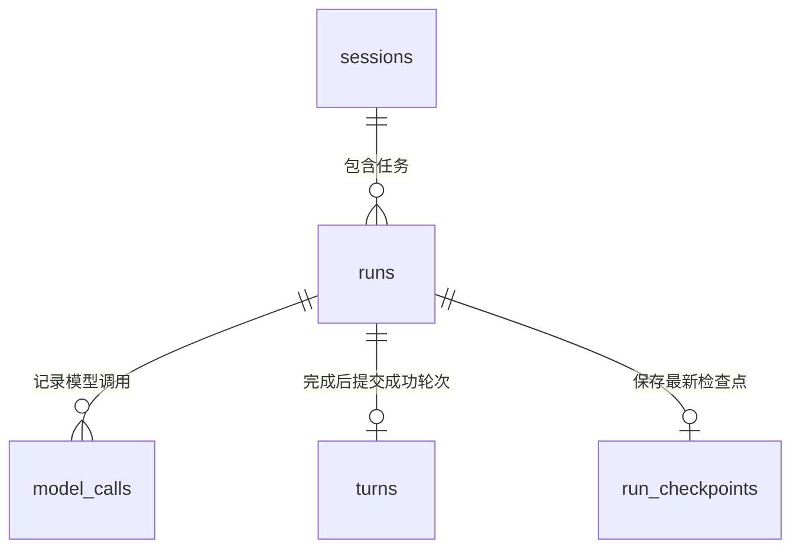

# G4a.2.1 对话检查点与中断恢复方案

**状态：方案已于 2026-10-24 获用户审核通过，实现尚未开始。** 用户将中断后的会话存储与恢复提到指令显示/skills 之前，并已确认本方案及表关系。本轮按最新要求先提交、推送文档，不开始代码或数据库迁移；其他路线不自动推进。

推荐“**SQLite 同库运行检查点 + 显式恢复**”：输入和关键工具状态及时保存，生成中的正文定期合并保存，重开后能看见已落盘进度。复用 `plume -c` 和 `/resume`，用户编辑并确认后才开始新任务。首版保持完整成功 turns 才进入模型上下文的规则；检查点是未完成展示记录，不是可自动重放的执行队列。

关联：[历史与公共指令契约](../specs/session-commands.md)、[键位](../specs/tui/keys.md)、[工具边界](../specs/agent/tools.md)、[TUI 操作手册](../runbooks/tui.md)、[G4a.1 审核](../reviews/G4a.1.md)。

## 1. 现状：已经能恢复什么

以下为当前代码和既有审核记录的核对结果，不是本轮新增能力。

| 场景 | 当前行为 | 重新打开后的边界 |
| --- | --- | --- |
| Esc / 运行中 Ctrl+C | 通常取消本次 run，TUI 留在当前会话；Esc 先关闭建议/面板 | 可直接继续输入，不需要退出重进 |
| 模型报错、断流、请求取消 | 标记失败或取消，保留当前已显示部分，回空闲 | 已完成且保存成功的旧轮次仍可使用 |
| `/exit`、退出键或 UI 返回错误 | 能返回主退出路径时，共用一个期限取消并尽力保存、释放资源 | 保存成功部分可恢复；收尾失败必须保留真实保存状态 |
| SIGTERM 等可被终端库处理的退出 | 通常进入退出收尾，不能据此保证所有信号/所有 goroutine 都可清理 | 以最终落盘结果为准 |
| 强杀、进程崩溃、关终端等无法保证收尾的情况 | 可能来不及执行保存和提示 | 下次启动将遗留 running 标为 interrupted，未落盘片段可能丢失 |

已经可用的恢复入口：

```bash
# 在原 tools.workspace 对应的工作区启动
plume -c
# 或 plume chat -c
```

`-c` 选择同一规范工作区、local 身份下最近有 run 的会话，不要求最后一次成功。恢复时校验原模型引用，完整成功 turns 才进入下一次模型请求。失败、取消、中断轮次只作展示。也可以先进入 TUI，再输入 `/resume <完整会话ID>`，精确打开指定会话。

| 数据 | 当前是否可恢复 |
| --- | --- |
| 完整成功轮次、已保存 usage | 可以；usage 未知值仍为 unknown |
| 已接受并成功登记起点的用户输入 | 可以；模型请求发送前已写 StartRun |
| 取消/失败时已通过终态事务保存的回答、Thought、工具摘要 | 可以作展示，不加入成功上下文 |
| 强退前尚未落盘的流式回答、Thought、工具摘要 | 不能保证；当前不逐片写盘 |
| 尚未提交的输入草稿、光标位置、上次进程的草稿历史 | 不保存 |
| 旧模型请求、工具执行进度 | 不恢复执行；文件或 Shell 已产生的副作用不会回滚 |

边界：`-c` 没有历史时沿用当前“明确提示后新建”的行为；配置不兼容、载荷超限、库被占用或损坏则明确拒绝，不以换模型、截断或清空数据库代替恢复。offline 或关闭历史没有跨进程会话恢复。

## 2. 三种方案与推荐范围

| 方案 | 内容 | 代价与结论 |
| --- | --- | --- |
| A：只补恢复提示 | 告知 `-c` / `/resume`，保留现在的终态集中保存 | 改动最少，但强退前的生成片段仍可能整段丢失 |
| **B：同库运行检查点 + 显式恢复（推荐）** | 重要步骤及时保存，流式正文合并写入，重开显示中断进度 | 复用 SQLite、锁与会话身份，需要一次存储迁移和有界写入协调 |
| C：自动接续执行 | 从中断位置重建模型与工具执行，自动继续任务 | 需要处理未确认副作用和不完整工具组，超出首个小单元 |

本次建议选 B，先解决“中途做到了哪里能保存下来”。首版不保存未发送的编辑草稿，不做自动接续执行。裸 `plume` 仍新建会话；只有显式 `-c` 或 `/resume` 才恢复旧会话，不增加默认自动恢复弹窗。

### 2.1 两层保存，分开消费

| 层次 | 保存内容 | 用途 |
| --- | --- | --- |
| 完整成功历史 | 沿用 turns 与终态 run 的原子事务，保留完整工具组 | 下一次模型请求的正式历史 |
| 当前 run 检查点 | 已产生的回答/Thought、工具调用ID与执行阶段、已完成工具摘要、快照序号 | 取消/崩溃后的展示和用户核对，不直接加入模型历史 |

两层都存同一个私密 `history.db`，不另建 JSONL 业务日志或第二个数据库；trace 仍不存正文。失败轮次不能因存在检查点而伪装成成功，恢复也不重新提交旧工具参数。

### 2.2 什么时候落盘

| 时机 | 计划行为 |
| --- | --- |
| 用户输入被接受 | 沿用 StartRun，输入和 running 起点先落盘，失败不发模型请求 |
| 模型生成正文/Thought | 目标每1秒合并保存一次最新完整快照，不对每个 token 写事务 |
| 准备执行工具 | 先确认写入调用ID、工具名和“待执行/结果未确认”状态，再允许开始副作用 |
| 工具完成 | 立即保存完成/失败状态及展示摘要；不等整轮模型成功 |
| 用户取消或可收尾退出 | 在已有收尾总期限内强制保存最新快照与终态 |
| run 完成或失败终态提交 | 完整展示并入 runs，成功 turns 按原规则提交，同时清除该 run 的检查点 |

1秒是合并写入的目标频率，不是断电时“最多丢1秒”的保证。强杀、磁盘错误和尚未确认的提交仍可能丢失最后片段，恢复只展示最后确认的快照。

正常写入使用单个协调器、有界的最新快照槽与单调序号；不为每个增量创建 goroutine 或积压无界队列。关键工具边界必须等待对应序号持久化，不能被合并策略跳过；迟到快照不能覆盖较新快照，也不能在终态提交后复活记录。取消后的刷盘使用独立收尾上下文，但仍受同一总退出期限约束。

这些约束由存储事务守住：原子校验所属主体/session/run、run仍为running及序号；同序号同载荷幂等，不同载荷冲突，不能只在协调器内做终态判断。后继完整快照必须保留此前工具状态；提交未知后，放行工具需要核实目标调用ID的准备记录或其后继状态，不能只看到更大的序号就视为已保存。

周期正文和关键边界的保存采用同一失败策略：首次保存错误即锁存，不能静默停止保存而继续正常生成。尚未开始的工具不执行；停止本次后续生成/工具，保留上一份有效记录并如实报告保存失败或未知。已经发生的副作用不回滚，不为补日志重跑工具。提交确认不明时按同一run/序号及目标调用状态核查，不能把超时当作确定未提交；正常用户取消则按收尾规则尽力刷盘。

### 2.3 崩溃后如何解释

下次启动仍把遗留 running 标为 interrupted，并关联最后一份检查点。完成工具摘要可展示；只有“准备执行/运行中”而无完成记录的工具，显示“执行结果未确认”，不能猜成未执行或已成功。

启动标记interrupted是检查点清理的例外：只更新状态和结束时间，保留该run的检查点供有界读取，不写turns、不因重开或重提新任务而删除它。重复启动必须幂等；损坏快照明确拒绝读取，不能先清掉仅存片段。正常finish路径只有在展示已原子并入runs后才清理检查点；终态确认未知时同时核查终态、成功turns及清理结果。

模型只收到已完整成功的历史。检查点中的半截回答、未完成工具组不直接进入请求；用户明确重提会创建新 run，可能重新规划和再次执行部分工作，不能宣称是从原执行位置续跑。以后若要把中断 run 内完整消息/工具组用于模型继续，另行设计恢复 DTO 与完整性规则，不在首版顺手接入。

### 2.4 表结构与一对多关系

会话和运行是一对多；一个run表示一次已接受的用户任务，内部可以多次调用模型及多个工具。检查点按run保存最新快照，不把每个流式增量都追加成操作行。



这是业务关系图；现有turns的主键是(session_id, seq)，与run的唯一成功提交由现行事务/幂等规则保证，不能误称现有DDL已对run_id建立唯一外键。

| 表 | 状态 | 核心字段与粒度 |
| --- | --- | --- |
| sessions | 已有 | id、scope_key、workspace、title、model_ref、created_at、last_run_at；一行对应一个会话 |
| runs | 已有 | id、session_id、input、status、reply、reasoning、tool_events、error、起止时间；每次用户任务一行，成功/失败/取消/中断都保留 |
| model_calls | 已有 | id、run_id、session_id、sequence、usage、saved_at；一个run可有多行，记录模型调用用量 |
| turns | 已有 | session_id、seq、run_id、messages、created_at；成功run提交一行，messages是包含user/assistant/tool的完整消息组JSON |
| run_checkpoints | 拟新增 | run_id为主键并引用runs；sequence、format_version、payload、saved_at；每个run至多一行最新快照 |

run_checkpoints的sequence是单调快照序号，format_version区分DTO版本，payload为有界JSON（已产生正文/Thought、工具调用ID/名称/阶段/摘要），saved_at为UTC毫秒。权限域、工作区和会话归属从run关联的sessions核对，不复制成可由调用方任意指定的第二份权限事实。

例如S1会话已有R1成功、R2中断：runs中保留两行，turns只有R1成功轮次；R2的最后片段在run_checkpoints中供展示。R2生成时持续更新同一检查点行并递增sequence；正常终态则同事务将展示并入runs并删除该行，硬中断后按上节保留。当前tool_events仍是run上的JSON展示摘要；本方案不新增一步一行的tool_events/event_log表，不宣称检查点能回放完整执行时间线。

## 3. 用户流程

### 3.1 能正常返回终端时，给出恢复方法

在线、历史开启且当前会话确有已登记 run 时，在 alt screen 退出、收尾结果确定后输出简短提示，包含会话 ID 与实际保存结论。

```text
Session: <完整会话ID>
History: saved
Latest conversation in this workspace: plume -c
This conversation: start plume, then /resume <完整会话ID>
```

同时说明要在对应工作区执行。`-c` 是“最近会话”，不能宣称一定是刚离开的会话：用户可能只是查看了一个较旧会话；精确恢复使用完整 ID 的 `/resume`。

保存为 failed/unknown 时如实显示，不打印 saved；保留原非零退出错误。尚未落盘的默认空会话不承诺能凭 ID 重开。offline/禁历史则明确没有跨进程恢复，不给出成功承诺。

保存结论必须绑定**当前会话与最后已登记 run ID**。不能直接沿用上一轮 `lastSaveStatus`，也不能因 `CloseContext` 返回成功就推导本轮已保存：例如新起点写入后发现退出已开始，可能还没有进入 finish。只有匹配本轮的终态保存已确认，或在同一退出期限内核查到对应终态，才能显示 saved；没有确认、仍为 running 或查询失败都显示 unknown。旧成功历史可恢复与最后任务是否保存完整是两件事，不合并成一个成功结论。

提示只使用已冻结的、身份仍有效的快照，或在已有总退出期限内取得的结果。收尾超时后不得再调用可能等待 `Service.mu` 的会话/状态 getter，也不为诊断开无界 goroutine、追加一次期限或阻塞等待。取不到可靠结论就显示 unknown；会话 ID 也无法确认时省略精确 `/resume` 指令，只说明 `-c` 的工作区范围。TUI 尚未启动就失败时保留启动错误，不假装创建可恢复会话。强杀时无法打印提示属于预期限制。

### 3.2 显式恢复后，说明当前状态

`-c`、`/resume` 和选择器恢复使用同一份展示转换与恢复信息：

- 展示会话、模型、完整成功轮数和最后 run 状态。
- 合并最后有效检查点与终态记录，已保存的回答、Thought 和工具摘要带终态标记；没有片段就显示中断状态，不生成虚构正文。未确认完成的工具单独标“结果未确认”。
- 只有最后一条 run 为 failed/cancelled/interrupted，才提供本次回填候选；不越过较新的成功 run 去找旧失败任务。
- 提示放在聊天记录的 system 展示行，不长期占据状态栏、遮住 ctx/cache；这些展示行不加入模型历史。

切换语义保持现行契约：真正已经提交的恢复必须同步到 UI，成功切换按原规则替换转录并清理旧草稿，不能丢弃回执使 UI/app 分叉；失败切换、过期只读预览或迟到回填不能覆盖当前会话及草稿。这里的“候选不自动填入”不等于忽略已提交切换。

示意文案（实际终端文案按项目约定使用英文）：

```text
· Session restored · 2 completed turns
· Last task: interrupted. It was not resent.
· Press ↑ to edit its input; Enter sends a new request.
```

原始输入可在已恢复转录中查看；不在错误消息、终端退出摘要或 trace 再复制正文。恢复成功本身的模型/工具调用数必须为 0。

### 3.3 按 ↑ 回填，编辑后才发送

不增加 `/retry` 或新的快捷键，复用现有输入历史行为：

1. 恢复成功后，只将最后一个未完成 run 的已保存输入放入本进程的输入历史候选；不自动填入输入框。
2. 未打开建议/面板时，↑ 按当前键位规则取回候选；若用户已有新草稿，先保留草稿，↓ 可返回，不能自动覆盖或发送。
3. 用户编辑后按 Enter，才走原公共输入路由并创建**新的 run**；旧 failed/cancelled/interrupted 记录保留，不改写为成功、不重复累计旧 usage。
4. 取消/错误后仍留在当前 TUI 时，复用本进程已有输入历史，不再重复插入一份；首次恢复与再次恢复也不能制造重复候选。历史候选统一表示已接受的消息正文；放回输入框时转换为可编辑输入，不能混存原始指令文本和已解码正文。

这是重新利用**已提交输入**，不是恢复从未发送的草稿。所有任务历史回填共用“净化控制序列 → 还原一次 slash 转义 → 按最终文本校验4096字符上限”的顺序，保留正常换行。超限明确拒绝，不静默裁剪，原草稿和历史游标均不变。↓取回的是用户原本正在编辑的草稿，原样恢复，不能再转义一次。

公共输入转义同时适用于跨进程恢复和当前会话历史：数据库 `run.Input` 与当前 Command 路径的输入历史都可能已经去掉 `//`。如果正文在空格/Tab 后以 `/` 开头，回填时补回一个 `/`，确保下一次解析仍是普通消息。例如保存的 `/tmp/a.txt` 回填为 `//tmp/a.txt`；`/exit`、`/new` 等字面正文不能因重填变成管理操作。命令错误本来不创建 run，不进入本候选。

静态审查确认当前同进程历史也存在这条边界：输入 `//exit` 后，Command 回执将解码后的 `/exit` 放入历史，↑直接回填会把它变成退出指令。因此本单元应修复共享回填行为，而不只处理数据库来源；仍需先写失败反例再改实现。

### 3.4 工具可能已经执行

恢复后不会自动发送“继续”、重试模型或重放工具。用户重新发送原问题属于新任务，可能再次修改文件或运行命令；恢复说明应提醒先核对已发生结果。

尤其进程被强杀时，数据库锁由操作系统释放不证明外部 Shell 子进程或外部操作已停止。首版不负责重新接管旧进程、推断工具是否完成或自动回滚；新任务仍按现有 read 摘要校验与工具许可执行。

## 4. 实施边界与拟改文件

在现有私密库增加 `run_checkpoints`，每个 run 只保留最新版本化快照，绑定已有 session/run、可信权限域和规范工作区。建议 SQLite user_version 从3迁移到4，表与版本同事务发布；旧历史与记忆账本不重写，迁移失败回滚。旧二进制拒绝v4，回退需恢复升级前备份；本轮尚未修改数据库。

快照使用独立版本化 DTO，UTF-8 JSON 总载荷上限8MiB、工具条目最多10000项，读取前预检，超限整次拒绝，不截断冒充完整记录。正常finish的终态写入、完整成功turns提交（仅成功时）与检查点清理必须同事务；启动标记interrupted按上节保留快照，终态后到达的旧写入不得复活或修改检查点。

不增加用户配置或运行时权限，合并间隔先固定并在测试中注入时钟。关闭持久历史/offline 不创建检查点文件或数据库，内存后端遵守同一快照契约但不承诺跨进程恢复。G4a.3.1 长期记忆账本不参与此功能。

| 文件/模块 | 拟变更 |
| --- | --- |
| `internal/store/` 检查点契约、双后端及迁移 | 有界快照、身份/序号校验、v4迁移与终态同事务清理 |
| `internal/app/service.go` 与有界写入协调 | 采集已产生的展示状态、合并文本快照、工具边界持久化及取消刷盘 |
| `internal/agent/` 工具边界回调 | 只有准备检查点已确认后才启动工具；许可、参数校验及工具循环语义保持原边界 |
| `cmd/plume/chat.go` | 收尾后输出保存状态和恢复方法，保留原错误及退出期限 |
| `cmd/plume/session_resume.go` | `-c` 展示与公共恢复共用转换，传递最后未完成输入候选 |
| `internal/app/commands.go`、`command_result.go` 等恢复快照 | 提供最小恢复信息，按可信身份与现有排序派生；不解析旧正文为指令 |
| `internal/tui/status.go`、`commands.go`、`model.go`、`update.go` | 接恢复候选、统一转录、输入历史回填与提示；IO 仍经异步 Hooks |
| 对应测试与 `scripts/pty_demo_g4a1.py` | 增加取消/失败/运行中退出后的重开、回填与零自动请求断言 |
| 键位/历史契约、runbook、审核、AGENTS/索引/路线图/每日记录 | 实现时同步更新；本轮只登记方案 |

具体 helper 落点在实施前按既有类型整理，不为复用而创建通用恢复框架或空包。现有 `-c` 未映射工具摘要而 `/resume` 已映射，应在本单元统一，不能扩大成整套指令 UI 重写。

## 5. 验收矩阵

下表是**待实现时执行的验收**。本轮只做静态核对，没有新增代码或重跑恢复 PTY；不将旧审核结果当作新增功能已通过。

| 场景 | 必须满足 |
| --- | --- |
| 文本合并写入 | 高频增量仅合并最新快照；序号递增、队列有界，不按token开事务 |
| 关键工具边界 | 准备记录确认后才执行工具；完成摘要及时保存，保存失败不启动下一工具 |
| 延迟写入与终态 | 旧序号不能覆盖新快照；终态提交与清理原子，迟到写入不能复活检查点 |
| 周期写失败/提交未知 | 锁存错误并停止后续生成/工具；仅有较大序号不能证明目标工具准备已保存 |
| 中断标记重复启动 | interrupted保留原检查点，不写turns、不重复改结束时间；正常finish清理须与展示合并同事务 |
| v3→v4迁移与载荷损坏 | 旧历史/记忆保留，DDL失败回滚，未来版本拒绝；损坏/超限快照不返回残片 |
| 正常完成后退出、`-c` | 成功上下文与统计恢复；无未完成候选，恢复零模型/工具调用 |
| 取消后留在 TUI | 保持空闲可输入；旧 run cancelled，↑可编辑原问题，↓保留新草稿 |
| 取消/模型错误后退出重开 | 未完成记录可见、完整成功历史不混入失败；↑回填但不发送 |
| 运行中 `/exit` 或空输入 Ctrl+D | 走退出收尾；期限内尽力保存，超时不冒充成功 |
| Ctrl+C 的取消与退出前提 | 运行中每次只请求取消；进入空闲且输入为空后，才按既有双击规则退出 |
| 可处理的 SIGTERM | 尝试收尾并重开；以真实终态判断，不硬编码必定 cancelled |
| SIGKILL/进程崩溃 | 起点及指定检查点确认后强退，重开为 interrupted；恢复到该检查点，不宣称保住其后未确认片段，无半组成功 turns |
| 以 `/` 开头的字面正文 | 覆盖空格/Tab、多重 slash、多行、净化后才露出的 slash 及最终4096边界；字面 `/exit`、`/new` 不执行管理动作 |
| 同进程 `//exit` 取消后再↑ | 回填仍为 `//exit`，Enter是普通消息；↓取回用户新草稿时不重复转义 |
| 保存确认未知后重开 | 按最终库状态核对；已完整提交的成功 run 不再提供未完成候选，不重试模型/工具 |
| 上一轮 saved、本轮起点后立即退出 | 摘要与本轮 run ID 关联，不能打印上一轮的 saved；未确认终态时为 unknown |
| 草稿/回执乱序 | 过期预览/回填不能覆盖新草稿；已提交的成功切换必须同步并按现行规则清稿，失败保持原状态 |
| `-c` 与 `/resume` | 原模型、转录、工具摘要、终态、回填候选一致 |
| 模型不兼容、历史超限/损坏、库被占用 | 明确拒绝；保留当前会话和草稿，不重置库或换模型 |
| 同毫秒/不同工作区/命名空会话 | 最近排序与规范工作区隔离保持现有契约，空会话不抢占 `-c` |
| 关闭历史、offline、未登记空会话 | 不宣称跨进程恢复，不创建用于本功能的新库/恢复文件 |
| 回填超限与控制字符 | 超限拒绝、原草稿不变，终端控制序列不执行 |
| 含工具副作用的失败任务 | 保存的完成摘要可见，无结果的工具标未确认；恢复与回填均不执行工具，只有用户重新发送才开始新 run |

验收使用隔离 `PLUME_HOME`、本地 HTTP fixture 和私密临时库，核对数据库状态、请求计数与成功/失败 trace。真实终端关闭、SIGHUP、Windows/Linux 若未实测保持 N/A，不从 SIGTERM 或 darwin PTY 推导。

实现后运行全仓普通/竞态、vet、lint、gofmt、`scripts/build.sh`，交付 `docs/reviews/G4a.2.1.md` 后停止。指标只报恢复场景成功率、恢复阶段模型/工具调用数及真实计时；未测记 N/A，不承诺续接生成或零丢失。

## 6. 已通过的设计决定与本轮范围

1. 采用同库检查点：工具关键边界及时保存、流式正文目标每1秒合并，按文档处理v3→v4的升级/回退。
2. 保留显式 `-c` / `/resume` 与 ↑ 回填：裸启动仍新会话，用户 Enter 后才发送新任务，不自动续跑。
3. 首版检查点仅作展示，模型仍只恢复完整成功历史；不保存未发送草稿，不承诺强退零丢失。

用户已审核通过方案。本轮仅提交并推送文档，代码、配置和数据库均未改变；实施范围只限本单元，不能将设计通过记成实现单元通过，不自动推进对话框/skills、记忆管理或其他阶段。

## 7. 参照与选择依据

官方资料核对日期为2026-10-24。Codex 将回合中断作为独立状态，并持久化会话项；Claude Code 持续保存消息及工具记录；Gemini CLI 自动保存会话，但部分取消路径会回退有效模型历史。由此可见持久记录与模型上下文需要分别定义，不能推断每个屏幕片段都已落盘。

- [Codex App Server](https://learn.chatgpt.com/docs/app-server)：持久会话项、JSONL及interrupted状态，恢复与开始turn分别操作。
- [Claude Code 会话恢复](https://code.claude.com/docs/en/sessions#what-a-resumed-session-restores)：消息、工具调用与结果的恢复边界。
- [Gemini CLI 会话保存](https://geminicli.com/docs/cli/session-management/)及[固定版本取消分支](https://github.com/google-gemini/gemini-cli/blob/cd1b45c2db0a5ea7b7fc3b67c1ba5879601d6005/packages/core/src/core/geminiChat.ts#L812-L839)：自动记录不等于保留全部未完成回合。

本方案采用同库快照，以复用现有SQLite契约并控制首版范围；不照搬其他工具的内部文件格式。1秒合并间隔、8MiB载荷上限和检查点仅展示都是Plume提案，尚未实现或测量。
