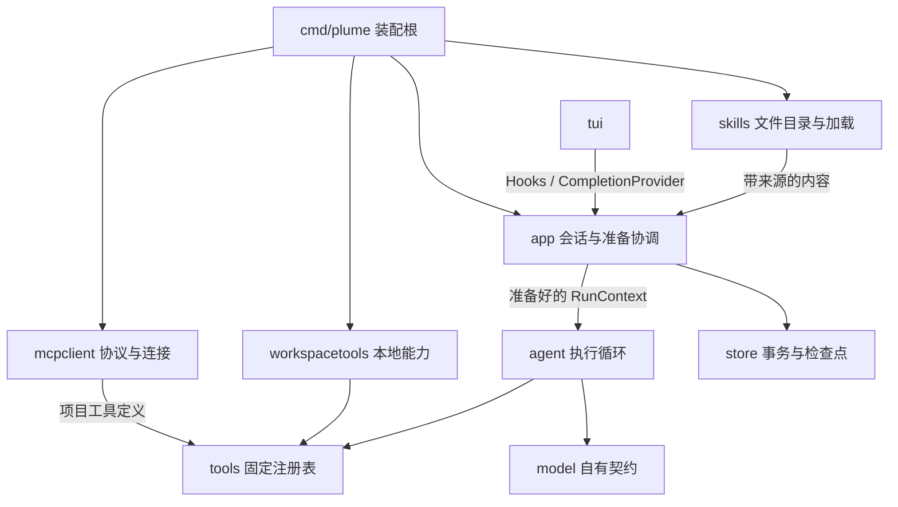

# 微内核边界与 Skills、MCP Tools 扩展设计

本文交付 **G5.0 设计稿**，依据用户 2026-10-25“明确这些规则，先写设计文档”的要求。以下新增接口、目录、配置、表结构和命令均为拟议方案，尚未实现。文档通过后仍按小单元逐项实施、验收；不因设计覆盖 MCP 就自动开始 MCP 实现。

基线为 `33f148d`：G4a.2.1 已验收并推送；历史库 v4、配置 schema v1；本地六工具与人格已接入，长期记忆仅有账本，skills/MCP 尚未接入。本文不改变 [模型决策](../decisions/0003-model-runtime.md)、[工具契约](../specs/agent/tools.md) 与 [恢复方案](2026-10-24-tui-recovery.md) 的现行行为。相关上下文来源见 [拼装规划](agent-context.md)。

## 1. 建议与范围

建议采用“**小内核 + 进程内能力适配器 + 显式装配**”：内核保持执行与一致性规则；技能以文件保存，按用户选择加载；MCP 经适配器变成同一种工具。先补齐已暴露的边界，再交付技能闭环，最后接 MCP。

| 选择 | 收益 | 代价与结论 |
| --- | --- | --- |
| 继续往 Runtime、Registry、TUI 添加具体来源分支 | 改动入口少 | 连接、文件读取、执行规则耦合增长，不选 |
| 小接口与明确装配，复用现有循环 | 本地、MCP、fake 共用执行语义；可逐单元迁移 | 需要搬出已有资源所有权，推荐 |
| 通用插件平台、动态库、事件总线 | 面向任意第三方插件 | 当前没有需求证明；增加版本协商与调试成本，暂不建设 |

本次覆盖架构规则、skills 存储与显式使用、运行来源留痕、工具统一接入、MCP stdio 首版及后续 HTTP 边界、TUI 必需交互。完整对话框视觉重做、自动技能匹配、技能市场/安装器、记忆召回、渠道接入与通用审批系统不并入本轮。

## 2. 微内核规则

当前实现是具有微内核特征的模块化单体；下面的目标不以动态加载或独立进程作为达标条件。判断标准是：**增加一种能力，主要改适配器与装配，不复制或修改执行循环的规则。**

| 编号 | 必须遵守的规则 | 审核时如何判断 |
| --- | --- | --- |
| K1 | `app` 管 session/run、串行、取消、恢复与持久一致性；`agent` 管模型—工具循环、预算与终止 | MCP/skill 包不能启动另一套模型循环或自行提交成功历史 |
| K2 | 核心消费项目自有类型，SDK、终端、协议连接类型止于适配器 | `agent/app` 不导入 MCP SDK、Bubble Tea、具体工具实现；协议 JSON 不变成通用内核参数 |
| K3 | 声明和执行入口必须来自同一冻结目录，许可由可信配置决定 | 未声明、未许可、重名或未知工具都不能执行；不按名字临时寻找可执行文件 |
| K4 | skill、人格、记忆、工具输出提供内容，不能授予能力 | `allowed-tools`、MCP annotations、正文要求均不能扩大 allowlist 或绕过预算 |
| K5 | 所有工具走同一入口与工具前后检查点 | 本地与 MCP 都先确认准备记录，再执行，再记录结果；检查点失败阻止后续副作用 |
| K6 | 一次 run 固定上下文及工具目录，更新只影响以后 run | 文件变更、tools/list_changed 不改变运行中声明；失联可使能力失败，不能换成别的能力 |
| K7 | 资源所有权明确且有界退出 | 创建者提供关闭路径，重复 Close 安全；使用共享退出总期限；进程退出不宣称远程操作已停止 |
| K8 | 恢复读取事实，不重新执行 | 历史 skill 内容、MCP 参数或旧工具调用不能启动进程、发送请求或恢复权限 |
| K9 | UI 只呈现状态、发送意图 | View/Update 不扫描技能、不连 MCP、不读数据库；候选和管理操作经异步 Hooks 注入 |
| K10 | 存储管事务和有界读取，不解释任务内容 | 不在 store 里匹配技能、拼 prompt、连接 MCP；不把 skill 源文件改成数据库唯一副本 |
| K11 | 失败有明确范围，未知不是失败回滚 | 可选扩展准备失败只移除该扩展并显示原因；发送后失联标为结果未确认，不自动重试 |
| K12 | 抽象随真实差异引入，不能先搭空平台 | 工具本地/MCP/fake、存储内存/SQLite 证明接口必要；不建立万能 Plugin 或多层同义转发 |

“配置许可”是本程序选择是否调用某工具的边界，并非操作系统沙箱。本地 bash 和 stdio server 仍可能拥有当前用户权限；远程 server 的权限由其服务端控制。本地文件工具的 `os.Root` 与先读后改证明不能被宣称自动覆盖 MCP。

### 2.1 当前差距与最小改动

| 实际位置 | 当前行为 | 建议调整 |
| --- | --- | --- |
| `internal/tools/registry.go` | 通用 Registry 同时持有具体 `*workspace` | 注册与执行契约留在 tools；工作区工具与资源移至 `internal/workspacetools` |
| `internal/agent/runtime.go` | Runtime 默认创建 Builtins，并代管 Registry 的资源关闭与会话重置 | 默认工具选择移至装配；app 接收明确的关闭/重置入口；Runtime 仅借用本轮工具目录 |
| `internal/agent/prompt.go` | 从 Registry 获取工作目录 | 工作目录作为准备好的运行环境传入，不通过工具反推环境 |
| `internal/tui/commands.go` | 直接实例化 BuiltinCompletionProvider | 注入组合 CompletionProvider；TUI 不知道候选来自技能还是内置指令 |
| `internal/store` | 契约、内存与 SQLite 同包 | 现在保留，避免无收益搬家；新增业务只依赖存储契约，未来新增后端时再评估物理拆包 |
| `internal/provider/factory.go` | 固定 switch 选择适配器 | 它属于装配，允许新增构造分支；不为了“微内核”强制改成动态注册 |

以上是待实施的差距清单，不能据此声称当前仓库已经满足所有目标依赖规则。

## 3. 模块与调用关系



箭头表示装配/数据调用关系，不表示每个箭头都需要新增 interface。`internal/skills`、`internal/mcpclient`、`internal/workspacetools` 为拟新增目录；前两者不依赖 TUI、app 服务或 store 实现。`cmd/plume` 只解析配置并装配，不承载扫描、协议处理和事务逻辑。

| 最小契约 | 输入与输出 | 所有权/边界 |
| --- | --- | --- |
| SkillCatalog | List 返回有界元数据；Load 接收精确 ID，返回校验后的文件内容及摘要 | skills 负责路径和格式；app 决定是否注入本轮 |
| ToolCatalog | 已许可 Definition 集合、稳定声明和按名称执行 | 沿用 tools.Registry；扩展提供定义，不获得循环控制权 |
| RunContext | 环境、按序来源、工具声明、目录摘要 | preparing 后只读；不含连接句柄/凭据 |
| 生命周期入口 | workspace 重置、能力组关闭 | 由装配创建，交给 app 协调；会话切换重置读取证明，退出关闭全部连接 |
| CompletionProvider | 请求前缀、当前可信作用域，返回结构化候选 | 多来源组合与限额在 app 边界；UI 只画候选 |

首版不用泛型 ContextProvider 列表：人格、技能各自有明确准备步骤；记忆召回尚未实现，不增加空实现。接口名是设计示意，最终代码需保持小而具体。

## 4. Skills 的存储与使用

### 4.1 文件是源数据

采用 Agent Skills 的 `SKILL.md` 格式：目录包含 YAML 元数据与 Markdown 指导，可带 references、scripts、assets。`name`、`description` 为必填；名称与父目录一致。该格式的 `allowed-tools` 仍是实验字段，Plume 将其视为说明，不转换成授权。[格式依据](https://agentskills.io/specification)

```text
<PLUME_HOME>/skills/<name>/SKILL.md       # 用户技能，默认目录
<workspace>/.plume/skills/<name>/SKILL.md # 项目技能，需该工作区显式启用
<PLUME_HOME>/config.json                # 开关、来源许可、MCP 配置与凭据引用
<PLUME_HOME>/sessions/history.db         # run 来源快照与历史，不作为技能编辑库
```

不自动扫描父仓库、其他产品的技能目录或网络地址。项目技能目录只有在用户级配置精确列出规范工作区路径后才读取；仓库文件不能自行启用自己。目录不存在视为空目录，不在普通启动中生成示例或安装依赖。

ID 使用 `user:<name>`、`workspace:<name>`；workspace ID 必须连同当前规范工作区解释。跨来源同名同时展示，要求显式选择，不静默覆盖。同一来源重复 ID 则该 ID 不可用并报告诊断。目录列表按来源、名称稳定排序；实际内容 SHA-256 是版本依据，metadata.version 只作展示。

新建用户目录沿用 0700、文件 0600；项目共享文件沿用仓库权限，不擅自 chmod。首版没有安装/修改入口；用户直接管理文件。以后若增加写入口，必须原子发布，失败保留旧文件。

### 4.2 发现、选择与加载

采用“目录元数据 → 选中指导 → 按需参考文件”的分层方式；这是 Agent Skills 的渐进加载思路。Plume 首版收窄为用户显式选择，不把所有技能目录发送给模型，也不让模型自动激活。[集成依据](https://agentskills.io/client-implementation/adding-skills-support)

拟新增公共指令：

| 输入 | 行为 |
| --- | --- |
| `/skills [prefix]` | 列表/过滤，可用性与来源可见；无模型调用 |
| `/skill use user:code-review` | 选择下一次用户发送所使用的技能；重复选择去重，最多 4 个 |
| `/skill clear` | 清空尚未发送的选择 |
| `/skill show user:code-review` | 只读预览，不能因此执行脚本或激活技能 |

选择只对**下一个新 run**有效，按选择顺序拼装。TUI 显示待用技能标签；选中候选不会发送任务。run 正式登记前失败则保留选择；登记成功即消费，之后即使生成失败也不自动留给下一轮。`/new`、成功 `/resume` 清空选择；切换失败保留。运行中禁止修改待用选择，返回 busy。公共命令不写成功模型历史；未来渠道重投沿用命令收据规则。

普通文本中的 `$name`、`@name` 首版保持字面量；不覆盖现有 `/` 路由与 `//` 转义。该取舍减少误触，后续自动匹配或行内引用另审。

加载发生在 preparing：按精确 ID 有界读取、校验、计算摘要，形成固定内容快照。选择后文件被修改，以 preparing 实际读取版本为准并显示版本摘要；文件删除、非法、无权读取或超过预算时，该 run 在模型调用前失败，不悄悄忽略用户选择。重复模型轮次不重复加载技能正文。

### 4.3 文件与资源边界

设计初始上限（不是标准要求）：每来源最多 128 个技能，元数据合计 256 KiB；单个 SKILL.md 64 KiB，frontmatter 8 KiB；一次最多 4 个技能、指导合计 256 KiB。另受整请求 8 MiB 或用户更紧预算约束。超限明确报错，不以任意遍历顺序取前 N 个。

YAML 拒绝重复键、对象标签、别名展开和多文档；元数据必须匹配支持类型，UTF-8 非法拒绝。每个无效技能单独不可用；目录级总量超限使该来源不可用，另一来源仍可用。列表只保存元数据与定位信息，不将所有正文常驻 prompt。

首版拒绝技能路径及子路径中的符号链接，拒绝绝对引用、`..` 逃逸与非普通文件；打开与读取须受根目录约束，不能只做字符串前缀检查。清单与读取有独立数量/字节限制。硬链接不构成沙箱保证，显式启用的目录仍需用户信任。

增加一个明确许可的只读工具 `skill_read`，仅在本轮有已选技能且配置 `skills.allow_resource_read=true` 时声明；参数为本轮精确 skill ID 与相对路径，不能列举/读取未激活技能。单次最多 64 KiB、本轮累计 256 KiB，不支持二进制或执行。参考文件在每次实际读取时形成带摘要的工具结果，同一 run 对同一路径复用第一次完整结果；正文变化不在半轮悄悄替换。它走同一工具预算、检查点和结果存储链路。

scripts 目录不会自动执行；文本脚本可像参考文件一样查看。若用户任务要求执行，仍须经已许可的 bash 等工具，并遵守其工作区与任务授权约束。不能因为 skill 被选中就额外开放 bash、网络或 MCP。

## 5. 配置与运行快照

### 5.1 拟议配置

沿用 schema v1 的兼容扩展原则，只有对应实现单元交付才加入字段并更新配置契约。下表为建议默认值，本次不修改真实配置。

| 字段 | 默认与含义 |
| --- | --- |
| `skills.enabled` | true；仅启用目录功能，空目录不产生模型上下文 |
| `skills.user_path` | `skills`，相对配置目录 |
| `skills.workspace_allowlist` | `[]`；精确规范工作区列表，启用对应 `.plume/skills` |
| `skills.allow_resource_read` | true；只授权读取用户本轮选中的技能资源，非任意文件工具 |
| `mcp.servers` | `[]`；无 server 时无连接、无后台进程 |

每个 MCP server 项拟包含：稳定 `id`、`enabled`（默认 false）、`transport`（首版只接受 stdio）、绝对可执行文件 `command`、字面 `args` 数组、显式绝对 `cwd`、`env_refs`（环境变量名到凭据引用）、`allowed_tools`（精确原始名称，默认空数组）、`startup_timeout_ms`（默认 10000）。未知字段保留，已知字段严格校验；重复 ID、空许可与 disabled 都不能意外变成全开放。每进程最多启用 8 个 server，顺序准备总计最多 30 秒，各步取父 context 更早期限。

工具 allowlist 是“用户允许 Plume 调用的功能”，server command/args/cwd 同时是用户授权启动的本机程序。禁止把 token 写进 args；敏感环境值从既有 credentials 解析，日志只显示引用状态。默认仅传所需平台环境（如 PATH/HOME/临时目录变量），不整体继承宿主环境；具体环境白名单须在实现验收固定。不会读取仓库 `.mcp.json` 自动启动程序。

配置在进程启动时固定；编辑配置需重启。技能文件与 MCP 目录可显式刷新，但不得重读凭据/修改配置许可。配置禁用历史时，来源与记录仅在内存后端存在；offline 不读取这些配置、技能或连接 MCP。

### 5.2 Prompt 与准备顺序

保持唯一 system：基础规则 → 人格 → 运行环境 → 未来记忆槽 → 本轮已选技能；技能区块带 ID、内容摘要与来源类型。工具声明仍是请求 Tools 字段，不嵌入 skill 正文。新增来源时升级 PromptVersion；来源标签提供解释，真正权限仍由执行代码约束。

顺序为：登记 run 与输入 → 读取本轮技能/人格 → 确认已许可工具目录 → 检查请求预算 → 保存不可变 RunContext → 登记模型调用 → 发送请求。后续每次工具执行都继续经过 G4a.2.1 检查点。取消贯穿准备过程，准备失败写 failed，不产生成功历史。

MCP 程序启动本身可有副作用，只允许在用户显式启用的配置下发生；不声称工具检查点能回滚 server 启动。普通恢复展示不准备 MCP；新任务准备或显式 `/mcp refresh` 才启动所需 server。

### 5.3 关系与拟议表结构

技能定义不入库。为说明“这次运行到底用过什么”，建议在 G5.2 引入 **run_contexts**，一个 session 有多行 runs，一个 run 最多一行不可变上下文快照；原工具调用、结果与检查点继续使用现有历史结构，不新造一套 MCP 操作表。

| 存储 | 保存什么 | 何时使用 |
| --- | --- | --- |
| SKILL.md 与资源文件 | 当前技能源数据 | 用户编辑、下一次准备时加载 |
| sessions / runs / 成功轮次 | 会话、任务、结果与可继续的完整历史 | 保持现有语义 |
| run_contexts（拟新增） | 当次所选技能正文、摘要、来源，实际工具声明与映射、准备版本 | 审计/展示；不作为恢复时的系统指令 |
| run_checkpoints | 运行中正文与每项工具的执行状态 | 保持 v4 的中断展示与未知副作用语义 |

拟议迁移为 **v4 → v5**（若中间另有迁移，实施时顺延）：

```sql
-- 来源快照属于 run；不跨库拆事务。
ALTER TABLE runs ADD COLUMN context_version INTEGER NOT NULL DEFAULT 0;
CREATE TABLE run_contexts (
    run_id TEXT PRIMARY KEY REFERENCES runs(id),
    format_version INTEGER NOT NULL,
    payload_json TEXT NOT NULL,
    payload_sha256 TEXT NOT NULL,
    created_at_ms INTEGER NOT NULL
);
```

字段名需在实施时对齐现有 runs 主键；这里展示逻辑结构。payload v1 包含按序的 skill `{id, scope, content_sha256, body}`、PromptVersion、工具 `{public_name, source_id, original_name, schema, description}` 及目录摘要；不保存凭据、环境值、远程会话令牌或可执行回调。skill 身份以来源+名称+工作区域确定；路径不充当跨工作区身份。单快照总量上限 2 MiB，最多 128 项工具和 4 项技能，JSON 深度/条目另有硬上限；超限在请求发出前失败。

新 run 登记 `context_version=1`，旧 run 为 0。准备完成以单事务写入快照，主键确保一份；重复同版本同载荷幂等，不同载荷拒绝。提交错误按同 run ID、版本、摘要及实际载荷核查；仍未知就阻止模型调用。`StartModelCall` 必须检查 v1 run 的完整快照已确认，避免未来调用方绕过准备顺序。准备失败、未调用模型的 run 允许没有快照。

快照保留至 run 被删除，不随终态清理；读取前先限条数/字节并核对归属、格式与摘要，不能先取出超大正文再检查。新旧格式分别校验；v0 历史缺来源显示 unknown，不猜测补齐。内存后端保持同契约；迁移必须原子回滚、保留旧数据，新版本库继续拒绝旧程序写入。

这份快照可核对技能指导与工具目录，不宣称能完全复现模型结果、外部文件或远端服务状态。参考资源的实际内容保存在对应工具结果中，不扫描备份整个技能目录。

恢复只还原会话转录和来源摘要，不重载 skill、不连接 MCP、不自动恢复待用选择。↑ 只回填原用户文本；历史显示“当时使用的技能”，用户需要重新选择后才应用于新 run。旧 skill 被删除或 MCP 下线，不应阻止只读历史展示；当前新任务采用当前许可及可用能力。

## 6. MCP Tools 接入

### 6.1 协议与 SDK 选择

选用官方 Go SDK，放在 `internal/mcpclient` 内。2026-10-25 查阅的 SDK 兼容表列明 v1.7.0+ 支持 2026-07-28 以及较早协议；这是选型依据，不代表本仓库已添加或验证依赖。G5.3 开工时锁定具体正式版本及 go.sum，验证 Go 1.27.1、许可、取消、消息限额与依赖增量，禁止浮动 `@latest`。[官方 SDK](https://github.com/modelcontextprotocol/go-sdk#version-compatibility)

首批协议验收范围为 **2026-07-28 与 2025-11-25**。新版按请求携带版本元数据，旧版使用 initialize 握手；stdio 的识别和兼容处理交给适配器/SDK，并各有 fixture，不能把“连接后统一 initialize”写成所有版本规则。不自动接受未验收版本，无法协商时报不兼容。[版本规则](https://modelcontextprotocol.io/specification/latest/basic/lifecycle)

首版仅 stdio；Streamable HTTP 为后续 G5.5。stdio 启动子进程，stdout 为协议流、stderr 为诊断流，不能把普通日志混入协议。HTTP 在协议中是独立传输，并非替换命令字符串即可支持。[传输依据](https://modelcontextprotocol.io/specification/2025-11-25/basic/transports)

### 6.2 发现与冻结

server 状态为 disabled / stopped / connecting / ready / unavailable / closing。只有 enabled 且 allowed_tools 非空的 server 参与新 run 准备。逐页获取 tools/list，收齐后校验并按许可过滤，再与本地工具合并；不可见工具不发给模型。缺少某个明确许可名称、重复名称、重复分页游标或非法 schema，使该 server 本次目录不可用，不发布半份目录。

发现上限：单 server 256 项原始工具、16 页、目录原始总量 1 MiB；合并后最多 128 项可声明工具；单 schema 64 KiB、嵌套深度 32。计数和原始字节在解码/构建大对象前限制。SDK 若不能给出可测试的消息限额，就在 transport 边界限制或判定该 SDK 路径暂不满足验收，不能声称已有保护。

工具身份为 `{source=mcp, server_id, original_name}`；模型可见名称为 `mcp_` 加该二元组规范编码的 SHA-256 前 40 位十六进制，固定 44 个 ASCII 字符。哈希后仍检查碰撞，冲突拒绝装配；本地工具禁止使用 `mcp_` 前缀。TUI 展示易读的 `server_id/original_name`，映射随 run 保存。原始名称仅作为 JSON 字段转发，不能拼进 shell。

已有 `tools/list`、`tools/call` 与目录变更通知可完成发现和调用。通知只将目录标脏：当前 run 继续使用既定映射，下一次 preparing 才刷新；不在工具调用中因名字缺失而重新发现后自动重发。[Tools 协议](https://modelcontextprotocol.io/specification/2026-07-28/server/tools)

### 6.3 参数与结果归一化

本地 Go struct 的严格解码不能直接套用任意 MCP schema。首版支持明确的 JSON Schema 子集：object/properties/required/additionalProperties（布尔）、array/items、string/number/integer/boolean/null、enum、数值范围、长度及数组数量约束。根必须 object，拒绝重复 JSON 键；`$schema` 仅接受明确支持的方言标识，`title/description` 为注释。`$ref`、组合条件、pattern/format 与其他未实现断言不得静默剥掉，相关工具标为 unsupported_schema；若它是明确许可工具，该 server 本次准备失败。具体解析/校验依赖在 G5.3 选定并列出方言与关键词测试，不自称完整 JSON Schema 支持。

只有可经当前 model 适配器无损表达的 schema 才能发布；适配器拒绝的声明在第一次模型请求前失败，不能临时弱化约束。参数依然受 1 MiB 或用户更紧上限约束，验证通过后才写工具准备记录并发送。

工具结果首版支持 text 内容以及有界 structuredContent JSON，保留内容顺序与结构，不把任意文本当执行指令。混入 image/audio/resource/link 等未支持块则返回明确 unsupported_result，不能只取 text 并假称完整；不自动下载链接。若返回 outputSchema，只接受同一可验证子集并校验结构结果。结果 JSON 总计受现有 64 KiB 或更紧上限；原始协议帧最多 2 MiB，越界关闭该连接并记录结果未确认/无法完整呈现，不能无界读取后截断。

`isError=true` 映射工具失败，允许模型读到有界错误结果；协议错误、断连与工具业务失败分别编码。新版 `input_required`、任务扩展、需要反向交互的结果首版返回 unsupported，不自动继续交互/再次调用。不开启 sampling、elicitation、roots、prompts、resources 或 MCP Apps；收到未声明反向请求明确拒绝。以上均为 Plume 的能力范围，不是声称协议没有这些功能。

### 6.4 调用、失败和退出

所有 MCP Execute 经过同一串行循环：许可与参数校验 → 工具准备检查点确认 → tools/call → 归一化结果 → 工具结果检查点 → 后续模型请求。模型 call ID、Plume 工具调用 ID 与 MCP 请求 ID 明确关联，不能用外部请求 ID 覆盖持久化身份。

单工具期限沿用 agent.budget，取本轮剩余期限与单次期限较早值。取消向 SDK 传播，并尽力通知/终止本地子进程；远端或已经产生的副作用不保证撤销。关闭坏连接不能阻塞超过统一退出期限；Unix 使用受控进程组清理，非 Unix 与脱离组进程局限如实现未覆盖须如实列出。

**tools/call 自动重试次数为 0**：包括 SDK 层、断线重连、版本降级与超时重发。版本确认只能在执行前的发现阶段完成。发送后无法确定结果，记录 `outcome_unknown` 并终止本轮，避免模型在同一 run 中自行重复副作用；用户可以核对结果后发起新任务。这个“未知副作用立即停轮”是统一工具结果语义的新增要求，需要连同本地结果兼容测试一起实施，不能只靠提示词。

连接/发现失败时，该 server 从新 run 目录排除，TUI 显示原因，普通聊天与本地工具可继续；用户明确选中的技能仍可加载，但不得声称其所需 MCP 已可用。若技能任务必须依赖该能力，模型只能报告当前不可用，不能凭 skill 获得连接许可。运行中掉线的工具不被替换；下一 run 或显式 refresh 才重建连接。

stderr 不直接输出到终端/普通 trace，也不默认保存原文；记录固定错误码、server ID、耗时与计数。必要诊断导出必须显式开启私密文件并有字节限制，不能把凭据或任务正文夹入日常日志。

## 7. TUI 与指令显示

拟增加 `/mcp`（只读状态）、`/mcp tools <server-id>`（缓存目录与许可情况）、`/mcp refresh <server-id>`（显式启动/刷新，运行中拒绝）。只读命令不启动进程；refresh 必须明确展示它会启动已配置程序，不改变配置或扩大许可。新建连接与刷新有可取消的 preparing 状态，不占用 View/Update。

候选面板统一显示“内置指令 / 技能 / MCP 管理”来源、标题与简短说明；命令候选和 skill ID 候选复用注入的 CompletionProvider，补全不加载正文或执行网络操作。异步结果带输入版本、会话 ID；过期结果丢弃，切换会话取消旧请求。

对话中以折叠块呈现技能来源和工具执行：等待、运行中、成功、失败、已取消、结果未确认。工具易读名、受控状态和摘要可见；参数/结果按现有私密历史与净化规则查看，不能让外部标题或说明注入终端控制序列。配置路径、SDK 名、JSON schema 等实现信息只放诊断详情，不占普通对话。

本轮不冻结完整视觉稿；完整 Codex CLI 风格对话框布局另交设计，以免架构审核与大规模 UI 改版绑定。这里先锁定交互语义，保证以后换布局不改执行规则。

## 8. 分单元实施与验收

以下编号为建议实施拆分，全部尚未开始；每单元实现前列拟改文件、演示命令和验收条件，完成后交 reviews 并停下。**G5.0 通过只批准设计，不同时批准后续全部实现。**

| 单元 | 可演示闭环 | 重点验收 |
| --- | --- | --- |
| G5.0 | 本设计与长期规则审核 | 当前/目标区分；存储、权限、恢复、协议范围无冲突 |
| G5.1 | 工具资源所有权与候选注入整理，行为不变 | Registry 不持有 workspace；agent 不建具体工具；现有六工具、关闭、切换与 TUI 回归 |
| G5.2a | 技能文件发现、预览与下一次选择 | 临时目录测试；同名不覆盖、非法/超限/逃逸拒绝；不调用模型、不启动脚本 |
| G5.2b | 所选技能进入新 run，来源留存与恢复展示 | v5 迁移及内存同契约、一次快照；skill_read、预算、取消；恢复零模型/工具/进程调用 |
| G5.3a | stdio fake server 发现与只读管理 | 锁定 SDK；新旧协议 fixture、分页/限额/未知 schema、许可与稳定命名 |
| G5.3b | MCP 经真实工具循环执行与恢复 | 工具前落盘；拒绝自动重试；断连未知停轮；取消/退出/终态检查点完整 |
| G5.4 | 指令/技能/工具卡片的统一对话展示 | 先审核视觉稿；PTY 验证过期候选、长文本净化、折叠与恢复，不改领域语义 |
| G5.5 | Streamable HTTP（后续独立授权） | TLS/重定向/凭据隔离、HTTP 生命周期与限额、鉴权；不将 stdio 通过等同 HTTP 可用 |

G5.2a 不引入尚无消费者的 run_contexts；G5.2b 才做迁移与 prompt 变更。G5.3a 只开放管理面发现，不向模型声明 MCP 工具；G5.3b 通过后才进入执行目录。新依赖分别随实际消费者单元加入并更新 AGENTS。

实施验收使用临时 PLUME_HOME、临时 workspace、脚本化模型和本地 MCP fixture；正常、错误、超限、取消、进程强退、未知提交均有确定性案例。关键门槛如下：

1. 同一 fake 工具以本地定义和 MCP 适配器接入，调用顺序、预算、检查点语义一致；增加 server 不修改 agent 循环。
2. skill 正文和 MCP metadata 含“启用未许可工具”时，执行仍被代码拒绝；未声明能力无法通过名称绕过。
3. 运行中修改技能或刷新工具目录，不改变本轮声明；下一 run 版本可追溯。
4. 断连发生在服务端副作用之后，工具调用次数仍为 1；恢复、预览、↑ 回填和只读管理均不发请求、不启动进程。
5. 来源快照保存失败/未知时，模型调用次数为 0；工具准备检查点失败时，server 工具执行次数为 0。
6. 迁移失败旧数据不变；v4 历史可以恢复，v5 来源损坏/越界明确失败；关闭历史使用内存且不建库。
7. MCP 禁用/缺失不阻塞本地普通聊天；已选 skill 无法加载明确失败；新 UI 不阻塞取消或退出总期限。

交付代码时运行 `rtk go test ./...`、`rtk go test -race ./...`、build/vet/lint/gofmt 与适用 PTY，真实外部 server 兼容性另列实际测过的名称/版本，未测记 N/A。本轮仅文档核对链接、frontmatter、路线图与 diff，不以未运行的代码测试冒充已验证实现。

## 9. 本次审核要点

建议确认这五项取舍：采用小内核与适配器；skills 文件为源数据、run 快照为私密留痕；首版显式选择且只对下一次发送有效；MCP 先 stdio、精确 allowlist、两种指定协议；按 G5.1 → G5.2a/.2b → G5.3a/.3b 逐项审核。设计通过后，将稳定架构规则整理为 ADR 和 AGENTS 现行约束，详细实现再按上述单元编写计划。

设计自审：保留现有唯一 system、成功历史与恢复隔离、持久化失败锁存；明确了源码文件与历史快照的权威边界、配置许可和操作系统权限的区别；不把待实现规则写成已支持。主要兼容性代价是首版不支持自动技能选择、任意 JSON Schema、多模态 MCP 结果与 HTTP，需要通过明确错误和状态展示让用户知道限制。
